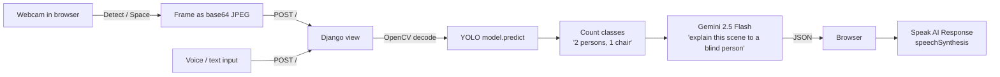

<div align="center">

# Object-Detection-with-yolov5

**A camera that sees, and a voice that tells you what it sees.**


</div>

---

## What it does

An assistive vision prototype for blind and low-vision users, built as a Django web app. The browser streams your webcam; when you press **Detect** (or the space bar) it grabs a frame, runs YOLO object detection on the server, and asks Gemini to describe the scene in as few words as possible. The answer can be read aloud with the browser's text-to-speech.

You can also talk to it: type a message or use voice input, and Gemini replies in the same short, plain style.

- Webcam capture in the browser (`getUserMedia`)
- Server-side object detection with Ultralytics YOLO (COCO classes)
- Detection summary such as `2 persons, 1 chair`
- Gemini 2.5 Flash scene description, with a system prompt tuned for blind users
- Speech-to-text input (Web Speech API) and text-to-speech output (`speechSynthesis`)

## How it works



1. `templates/index.html` captures a frame from the `<video>` element onto a canvas and POSTs it as a data URL.
2. `yolo/views.py` decodes it with OpenCV, runs `model.predict`, and counts detected labels.
3. The counts become a prompt for `yolo/Gemini.py`, which calls `gemini-2.5-flash` via the `google-genai` SDK.
4. The view returns the detection summary and AI response as JSON; the page displays them and can speak them aloud.

### A note on the model

The repo is named after YOLOv5, and YOLOv5 weights (`yolov5s.pt`, `yolov5su.pt`) are included, but `yolo/views.py` currently loads **`yolo11n.pt`** (Ultralytics YOLO11 nano). To switch back, edit the model line in `yolo/views.py`:

```python
model = YOLO("yolov5su.pt")
```

## Tech stack

- **Backend:** Django
- **Detection:** Ultralytics YOLO (YOLO11n by default, YOLOv5 weights included), OpenCV, NumPy
- **Language:** Google Gemini 2.5 Flash via `google-genai`
- **Frontend:** plain HTML + JavaScript, Web Speech API (recognition + synthesis)

## Project structure

```text
Object-Detection-with-yolov5/
├── web_/                    # Django project root (run manage.py from here)
│   ├── manage.py
│   ├── web_/                # settings, urls, wsgi/asgi
│   ├── yolo/                # app
│   │   ├── views.py         # frame -> YOLO -> Gemini pipeline
│   │   ├── Gemini.py        # Gemini client + system prompt
│   │   └── BlackBox.py      # unused experimental Selenium chat backend
│   ├── templates/index.html # camera, detect, voice, speak UI
│   └── yolo11n.pt, yolov5su.pt
└── detection_results.txt    # sample log from an earlier version
```

## Quickstart

```bash
git clone https://github.com/nabeelalikhan0/Object-Detection-with-yolov5.git
cd Object-Detection-with-yolov5/web_

python -m venv .venv
# Windows: .venv\Scripts\activate    macOS/Linux: source .venv/bin/activate
pip install django ultralytics opencv-python numpy google-genai
```

Set your Gemini API key (the `google-genai` client reads it from the environment):

```bash
# macOS/Linux
export GEMINI_API_KEY=your-key-here
# Windows PowerShell
$env:GEMINI_API_KEY="your-key-here"
```

Run it:

```bash
python manage.py migrate
python manage.py runserver
```

Open http://127.0.0.1:8000, allow camera access, and press **Detect** or the space bar. Voice input uses `webkitSpeechRecognition`, so use a Chromium-based browser (Chrome / Edge) for that feature.

---

<div align="center">

Built by [Nabeel Ali Khan](https://github.com/nabeelalikhan0) · [ChanakyaAI](https://www.chanakyaai.in)

</div>
